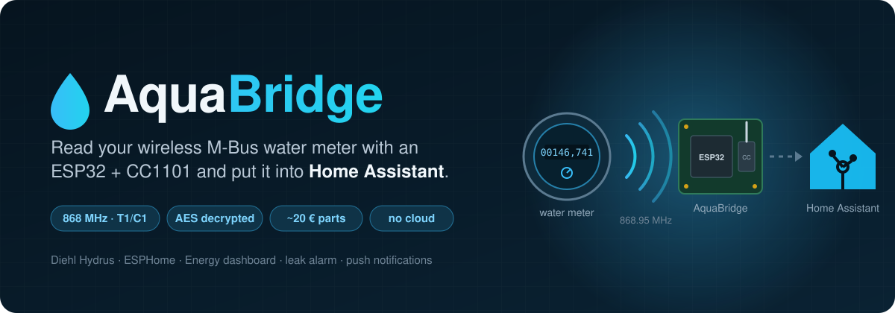
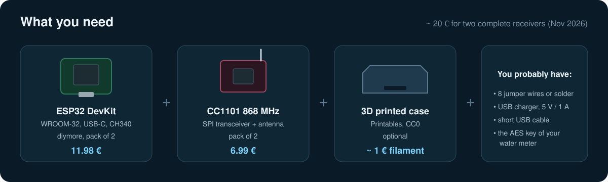
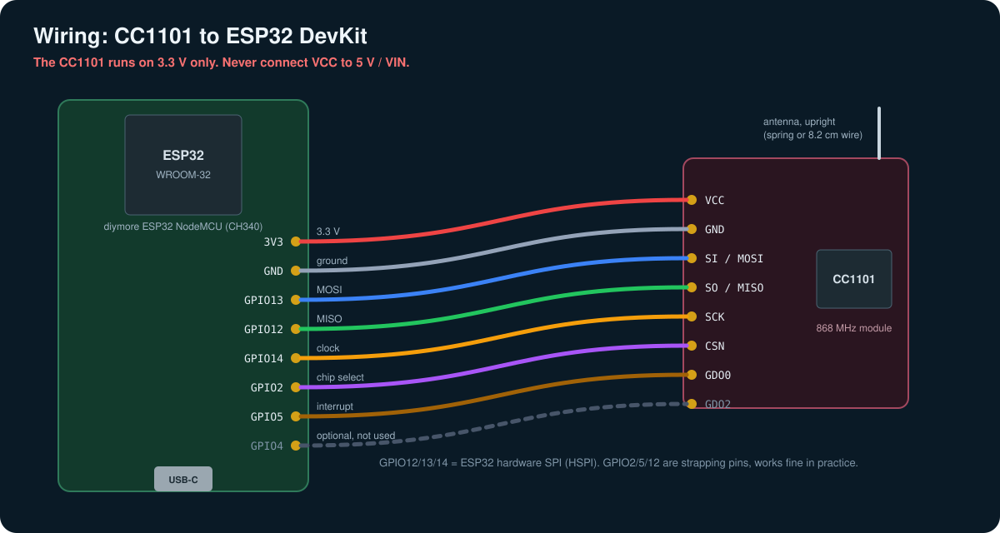
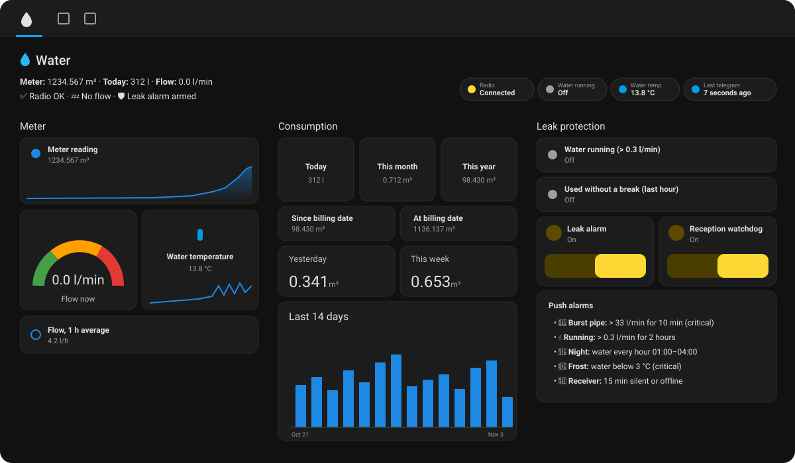
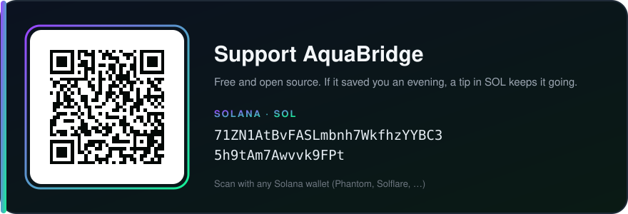

<div align="center">



**Dein Wasserzähler funkt sowieso. AquaBridge hört zu.**<br>
Ein Empfänger für rund 10 €, der die verschlüsselten Funktelegramme deines wM-Bus-Wasserzählers
auffängt, lokal entschlüsselt und als saubere Sensoren an Home Assistant gibt. Ohne Cloud, ohne Gateway, ohne Abo.

[English](README.md) · [Teile](#was-du-brauchst) · [Schnellstart](#schnellstart) · [Anleitung (EN)](docs/04-flashing.md) · [Unterstützen](#unterstützen)

</div>

---

## Worum geht's

Viele Wasserzähler, die in den letzten Jahren eingebaut wurden, haben einen Funksender. Alle paar
Sekunden schicken sie ihren Zählerstand auf 868 MHz in die Luft, damit der Versorger ihn einmal im Jahr
im Vorbeifahren abholen kann. Das Telegramm ist AES-verschlüsselt, aber der Schlüssel gehört zu
*deinem* Zähler, und die meisten Versorger rücken ihn auf Nachfrage raus.

Mit diesem Schlüssel und einem ESP32 plus CC1101 hast du deinen Wasserverbrauch in Home Assistant:
jeden Liter, jede Stunde, jeden Tag. Du siehst, wenn die Klospülung nachläuft, bekommst eine Push-Nachricht
bei einem Rohrbruch, und im Energie-Dashboard steht das Wasser endlich neben dem Strom.

Getestet mit einem **Diehl Hydrus 2.0 (Type 173)**. Andere wM-Bus-Zähler funktionieren, wenn
[wmbusmeters](https://github.com/wmbusmeters/wmbusmeters) einen Treiber dafür hat (IZAR, Multical 21,
Apator, Itron, Sensus, Zenner, Techem und viele mehr).

## Was du brauchst



| Teil | Was ich gekauft habe | Preis (Nov. 2026) |
|---|---|---|
| ESP32 | [diymore ESP32 NodeMCU, USB-C, CH340, 2 Stück](https://www.amazon.de/dp/B0D9BTQRYT) | 11,98 € |
| Funkmodul | [CC1101 868 MHz, 2 Stück](https://www.amazon.de/dp/B0FB3K3CQP) | 6,99 € |
| Gehäuse (optional) | [ESP32 + CC1101 Case (USB-C Devkit)](https://www.printables.com/model/1736736-esp32-cc1101-case-usb-c-devkit) von danoman, 3D-Druck | ~1 € Filament |
| Strom | ordentliches USB-Netzteil 5 V / ≥ 1 A, **kurzes** Kabel | – |
| Schlüssel | den AES-Schlüssel deines Zählers vom Versorger | kostenlos |

> [!IMPORTANT]
> Unbedingt die **868-MHz**-Version des CC1101 nehmen. Die 433-MHz-Module sehen gleich aus, hören auf
> 868 MHz aber praktisch nichts.

Den AES-Schlüssel bekommst du vom Wasserversorger bzw. Messdienstleister. Eine fertige Briefvorlage
auf Deutsch findest du in [docs/03-aes-key.md](docs/03-aes-key.md#letter-template-german).

## Verdrahtung



| CC1101 | ESP32 |
|---|---|
| VCC | **3V3** (nie 5 V!) |
| GND | GND |
| SI / MOSI | GPIO13 |
| SO / MISO | GPIO12 |
| SCK | GPIO14 |
| CSN | GPIO2 |
| GDO0 | GPIO5 (Pflicht) |
| GDO2 | GPIO4 (wird nicht gebraucht) |

## Schnellstart

```bash
pipx install esphome
git clone https://github.com/Secoolioo/AquaBridge.git
cd AquaBridge/esphome
cp secrets.example.yaml secrets.yaml        # WLAN, AES-Schlüssel, API-Schlüssel eintragen
```

In `aquabridge.yaml` die Zählernummer als **Hex** eintragen: Auf dem Typenschild steht z. B.
`8 DME76 1234 5678`, dann ist es `meter_id: "0x12345678"`. Ohne `0x` wird die Zahl dezimal gelesen und
dein Zähler nie erkannt.

```bash
esphome config aquabridge.yaml                     # "Configuration is valid!"
esphome run aquabridge.yaml --device /dev/ttyUSB0  # erster Build dauert 10-20 min
```

Dann den ESP **nah an den Zähler** stellen (0,5 bis 2 m, Antenne nach oben, nicht im Metallschrank) und
an ein USB-Netzteil hängen. Home Assistant findet ihn unter *Einstellungen → Geräte & Dienste → ESPHome*.
Den Wert **Total** mit dem Display vergleichen: Er muss auf den Liter stimmen.

## Home Assistant



<sub>Das mitgelieferte Dashboard, mit Beispielwerten.</sub>

Das Repo bringt fertige Konfiguration mit:

- [Helfer-Paket](homeassistant/packages/aquabridge.yaml): Wasser heute / Monat / Jahr, Durchfluss,
  „Wasser läuft“, „Verbrauch ohne Pause“
- [Leck-Alarm](homeassistant/automations/leak_alarm.yaml): Rohrbruch, 2 Stunden Dauerlauf, nächtlicher
  Verbrauch, Frost am Zähler. Push aufs Handy, beim iPhone als kritische Mitteilung
- [Empfangs-Wächter](homeassistant/automations/reception_watchdog.yaml): ESP offline oder Zähler stumm
- [Dashboard](homeassistant/dashboard/water-dashboard.yaml): drei Ansichten, nur Standard-Karten

Alles erklärt in [docs/05-home-assistant.md](docs/05-home-assistant.md) (Englisch).

## Was ich auf die harte Tour gelernt habe

- **Abstand ist alles.** Am Schreibtisch zwei Stockwerke höher kamen die Telegramme mit Bitfehlern an
  und wurden stillschweigend verworfen. Im Keller neben dem Zähler kommt jedes einzelne an.
- **`meter_id` muss Hex sein**, sonst passiert gar nichts.
- **Billige ESP32-Boards haben manchmal empfindliche Flash-Chips.** Bei meinem (XTX XT25F32B) hat ein
  Funk-Update an einem schwachen Netzteil den Flash beschädigt, einmal sogar den Bootloader. Am USB des
  PCs klappt alles. Lösung in einer Minute: [Troubleshooting](docs/06-troubleshooting.md#ota-update-fails-or-the-board-is-dead-after-an-update).
- **`version_4` der Komponente läuft mit aktuellem ESPHome nicht mehr.** Den `main`-Zweig nehmen,
  auf einen Commit gepinnt, wie in der `aquabridge.yaml`.
- **„UNKNOWN_80“ ist kein Fehler**, sondern ein Herstellerbit von Diehl.

## Komplette Anleitung (Englisch)

1. [Hardware](docs/01-hardware.md): was, warum, wo hinstellen
2. [Verdrahtung](docs/02-wiring.md)
3. [AES-Schlüssel](docs/03-aes-key.md) mit Briefvorlage
4. [Flashen und erster Start](docs/04-flashing.md)
5. [Home Assistant](docs/05-home-assistant.md)
6. [Fehlersuche](docs/06-troubleshooting.md)
7. [Wie es funktioniert](docs/07-how-it-works.md)

## Danke an

[SzczepanLeon/esphome-components](https://github.com/SzczepanLeon/esphome-components),
[wmbusmeters](https://github.com/wmbusmeters/wmbusmeters), [ESPHome](https://esphome.io),
[Home Assistant](https://www.home-assistant.io) und danoman für das
[Gehäuse](https://www.printables.com/model/1736736-esp32-cc1101-case-usb-c-devkit).

## Unterstützen

AquaBridge ist kostenlos und Open Source. Wenn es dir einen Abend (oder einen nassen Keller) erspart hat,
freue ich mich über ein kleines Trinkgeld.

<p align="center">
  
</p>

**Solana (SOL):**

```text
71ZN1AtBvFASLmbnh7WkfhzYYBC35h9tAm7Awvvk9FPt
```

Ein ⭐ fürs Repo hilft auch.
