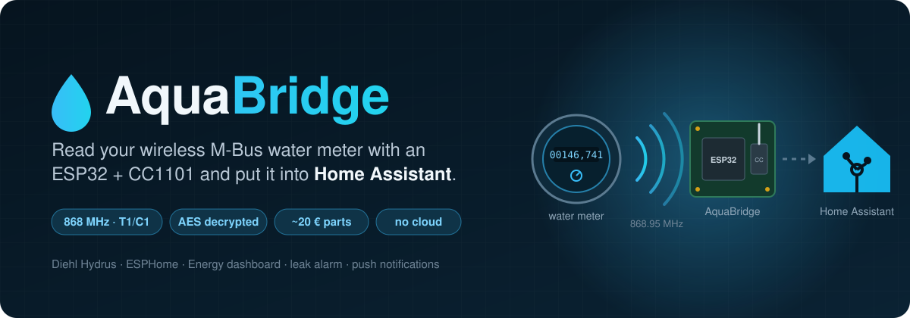
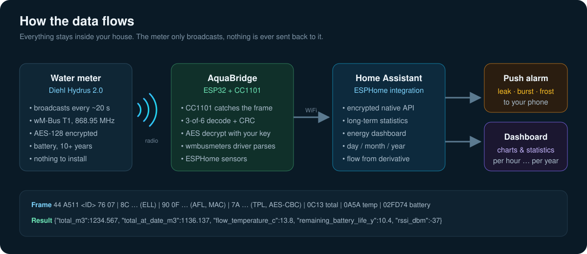
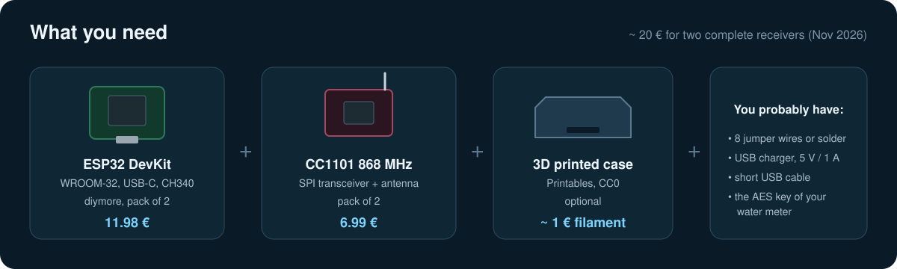
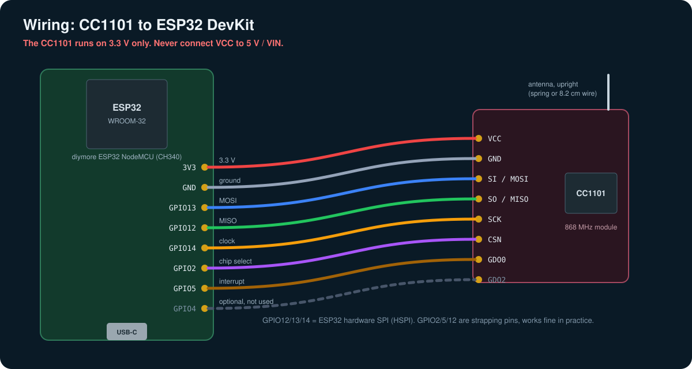
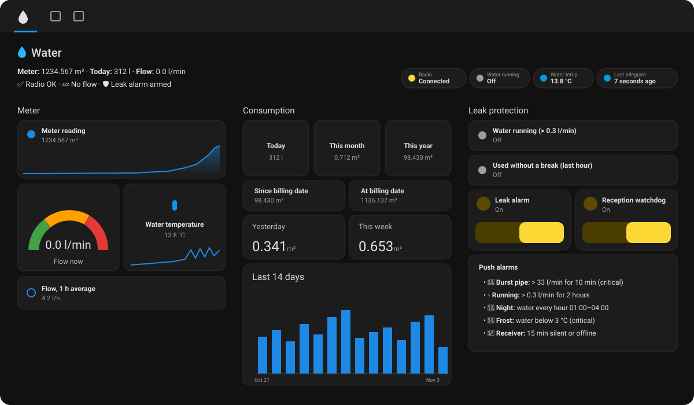
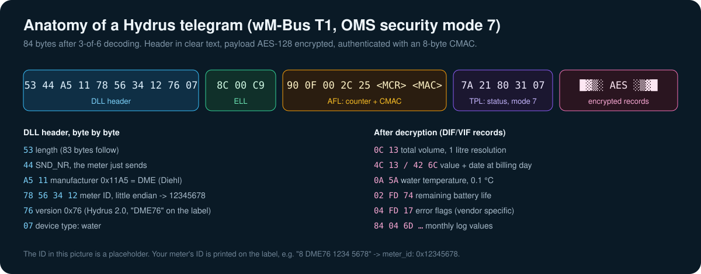
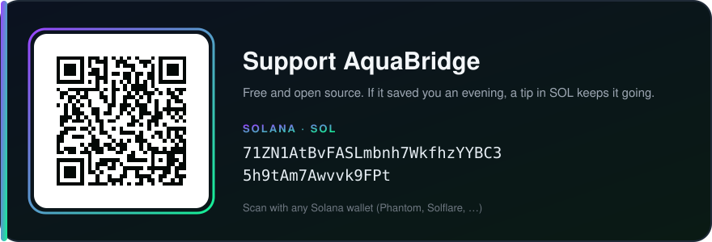

<div align="center">



<br>

[](https://esphome.io)
[](https://www.home-assistant.io)
[](docs/07-how-it-works.md)
[](LICENSE)

**Your water meter already talks. AquaBridge listens.**<br>
A ~10 € receiver that picks up the encrypted radio telegrams of your wireless M-Bus water meter,<br>
decrypts them locally and hands clean sensors to Home Assistant. No cloud, no gateway, no subscription.

<sub>ESP32 + CC1101 · ESPHome · tested on a Diehl Hydrus 2.0 (Type 173) · works with most wM-Bus meters that wmbusmeters knows</sub>

[Quick start](#quick-start) ·
[Parts](#what-you-need) ·
[Wiring](#wiring) ·
[Flashing](docs/04-flashing.md) ·
[Home Assistant](#home-assistant) ·
[Troubleshooting](docs/06-troubleshooting.md) ·
[How it works](docs/07-how-it-works.md) ·
[Deutsch](README.de.md) ·
[Support](#support-the-project)

</div>

---

## Why

A lot of water meters installed in the last years have a radio inside. Twice a minute they shout their
reading into the air on 868 MHz so the utility can collect it once a year by driving past the house.
The telegram is encrypted, but the key belongs to *your* meter, and most utilities hand it out if you
ask nicely.

With that key and about 10 € of hardware you get your own water consumption in Home Assistant:
every litre, every hour, every day. You see when the toilet keeps running, you get a push when a pipe
bursts, and the Energy dashboard finally shows water next to electricity.

I built this for the Diehl Hydrus in my basement. It took one evening and a few surprises,
all of which are written down here so it takes you less.

## What you get

 radio -> AquaBridge -> WiFi -> Home Assistant -> push alarm and dashboard" width="100%">

| | |
|---|---|
| 💧 **Meter reading** | the register of the meter, 1 litre resolution, updated every ~20 seconds |
| 📈 **Consumption** | today / this month / this year, plus long-term statistics and the Energy dashboard |
| 🚿 **Flow** | litres per minute, derived from the register (the meter does not send it) |
| 🌡️ **Water temperature** | measured inside the meter, handy as a frost warning |
| 🔋 **Battery life** | remaining years reported by the meter |
| 📅 **Billing date** | reading at the last billing date and usage since then |
| 🚨 **Leak alarm** | burst pipe, water running for hours, usage all night, frost. Push to your phone |
| 📡 **Watchdog** | push when the receiver is offline or the meter goes silent |
| 🔐 **Local & encrypted** | AES decryption on the ESP32, encrypted API to Home Assistant, nothing leaves your network |

## Does it work with my meter?

You need three things:

1. **A wireless M-Bus meter on 868 MHz** sending in mode **T1 or C1**. Most European water meters do.
   Look for "wM-Bus", "OMS", "868 MHz" or a little radio symbol on the display.
2. **A driver in [wmbusmeters](https://github.com/wmbusmeters/wmbusmeters)**. The ESPHome component
   uses its drivers: Diehl Hydrus / IZAR, Kamstrup Multical 21, Apator, Itron, Sensus, Zenner,
   Techem and many more.
3. **The AES key** if the telegrams are encrypted (almost always). See
   [docs/03-aes-key.md](docs/03-aes-key.md), including a letter template for your utility.

| Tested | Result |
|---|---|
| Diehl Hydrus 2.0, Type 173, version 0x76, T1, AES mode 7 | ✅ every telegram decoded, total / billing date / temperature / battery |

If you get it running with another meter, open an issue or a PR and I'll add it to the table.

## What you need



| Part | What I bought | Price (Nov 2026) |
|---|---|---|
| ESP32 board | [diymore ESP32 NodeMCU, USB-C, CH340, pack of 2](https://www.amazon.de/dp/B0D9BTQRYT) | 11.98 € |
| 868 MHz radio | [CC1101 868 MHz wireless transceiver, pack of 2](https://www.amazon.de/dp/B0FB3K3CQP) | 6.99 € |
| Case (optional) | [ESP32 + CC1101 Case (USB-C Devkit)](https://www.printables.com/model/1736736-esp32-cc1101-case-usb-c-devkit) by danoman, CC0 | ~1 € filament |
| Power | any decent USB charger 5 V / ≥ 1 A and a **short** cable | – |

Why exactly these parts, what to watch out for and alternatives: [docs/01-hardware.md](docs/01-hardware.md).

> [!IMPORTANT]
> Buy the **868 MHz** version of the CC1101. The 433 MHz modules look identical but are tuned for the
> wrong band and will hear almost nothing.

## Quick start

```text
1. Get the AES key of your meter from the utility          -> docs/03-aes-key.md
2. Wire the CC1101 to the ESP32 (8 wires, 3.3 V!)          -> docs/02-wiring.md
3. Install ESPHome:          pipx install esphome
4. Clone this repo:          git clone https://github.com/Secoolioo/AquaBridge.git
5. cd AquaBridge/esphome && cp secrets.example.yaml secrets.yaml   (fill it in)
6. Set your meter ID in aquabridge.yaml (label "8 DME76 1234 5678" -> 0x12345678)
7. Plug the ESP32 into USB:  esphome run aquabridge.yaml --device /dev/ttyUSB0
8. Put the receiver close to the meter, watch the logs      -> docs/04-flashing.md
9. Home Assistant finds it: Settings -> Devices & services -> ESPHome -> Configure
10. Add helpers, automations and the dashboard              -> docs/05-home-assistant.md
```

The whole thing, step by step, with every command and the log output you should see: **[docs/04-flashing.md](docs/04-flashing.md)**.

## Wiring



| CC1101 | ESP32 | Purpose |
|---|---|---|
| VCC | **3V3** | power, 3.3 V only |
| GND | GND | ground |
| SI / MOSI | GPIO13 | SPI data to the radio |
| SO / MISO | GPIO12 | SPI data from the radio |
| SCK | GPIO14 | SPI clock |
| CSN | GPIO2 | chip select |
| GDO0 | GPIO5 | "FIFO has data" interrupt, **required** |
| GDO2 | GPIO4 | not used, can stay connected |

More photos, soldering tips and the antenna: [docs/02-wiring.md](docs/02-wiring.md).

## Flashing

```bash
pipx install esphome
cd AquaBridge/esphome
cp secrets.example.yaml secrets.yaml      # WiFi, AES key, API key
esphome config aquabridge.yaml            # must say "Configuration is valid!"
esphome run aquabridge.yaml --device /dev/ttyUSB0
```

The first build downloads the ESP-IDF toolchain (a few GB, 10–20 minutes). After that a build takes a minute.
On the first boot you should see:

```text
[C][wmbus.transceiver]: Transceiver: CC1101
[C][wmbus_meter]:   ID: 0x12345678
[C][wmbus_meter]:   Driver: hydrus
[I][wmbus]: Receiver task created
```

Everything about the first boot, finding your meter in the air and reading the decrypted JSON:
[docs/04-flashing.md](docs/04-flashing.md).

## Home Assistant



<sub>The included dashboard, shown with example values.</sub>

The ESP32 shows up as a new ESPHome device. Enter the API key from your `secrets.yaml` and you get:

| Entity | Example |
|---|---|
| `sensor.water_meter_total` | 1234.567 m³ |
| `sensor.water_meter_total_at_billing_date` | 1136.137 m³ |
| `sensor.water_meter_usage_since_billing_date` | 98.430 m³ |
| `sensor.water_meter_water_temperature` | 13.8 °C |
| `sensor.water_meter_battery_life` | 10.4 a |
| `sensor.water_meter_meter_signal` | -37 dBm |
| `sensor.water_meter_last_telegram` | 12 seconds ago |
| `binary_sensor.water_meter_meter_reception` | Connected |

On top of that this repository ships ready-to-use Home Assistant configuration:

| File | What it does |
|---|---|
| [`homeassistant/packages/aquabridge.yaml`](homeassistant/packages/aquabridge.yaml) | water today / month / year, flow in m³/h, "water running" and "used without a break" |
| [`homeassistant/automations/leak_alarm.yaml`](homeassistant/automations/leak_alarm.yaml) | burst pipe, running for 2 h, night usage, frost. Critical push on iPhone |
| [`homeassistant/automations/reception_watchdog.yaml`](homeassistant/automations/reception_watchdog.yaml) | receiver offline / meter silent / back again |
| [`homeassistant/dashboard/water-dashboard.yaml`](homeassistant/dashboard/water-dashboard.yaml) | complete dashboard with 3 views, built-in cards only |

All of it explained, including the Energy dashboard and the UI way without YAML:
[docs/05-home-assistant.md](docs/05-home-assistant.md).

## Things I learned the hard way

- **Distance matters more than you think.** On my desk two floors up the receiver caught the meter,
  but every frame had a few bit errors and was silently dropped. In the basement, half a metre from the
  meter, 100 % of the telegrams arrive at -32 to -40 dBm.
- **`meter_id` must be hex.** `0x12345678`, not `12345678`. The decimal version becomes a different ID
  and nothing ever matches.
- **Cheap ESP32 boards can have flaky flash chips.** Mine has an XTX XT25F32B. On a weak USB charger,
  over-the-air updates corrupted the flash and once even wiped the bootloader. On the PC's USB port
  everything is fine. Details and the 1-minute fix in [troubleshooting](docs/06-troubleshooting.md#ota-update-fails-or-the-board-is-dead-after-an-update).
- **`version_4` of the component no longer works** with current ESPHome (boot loop). Use the `main`
  branch, pinned to a commit, as in [`aquabridge.yaml`](esphome/aquabridge.yaml).
- **"UNKNOWN_80" is not an error.** Diehl uses vendor-specific status bits. The leak detection here works
  with the flow instead.

## How it works



The CC1101 is tuned to 868.95 MHz and listens for the wM-Bus sync word. Each T1 frame is 3-of-6
encoded; the ESP32 decodes it, checks the CRCs, verifies the CMAC and decrypts the payload with AES-128.
The wmbusmeters driver then turns the DIF/VIF records into named values like `total_m3`.
The long version: [docs/07-how-it-works.md](docs/07-how-it-works.md).

## Repository layout

```text
AquaBridge/
├── esphome/
│   ├── aquabridge.yaml          # the firmware configuration
│   ├── secrets.example.yaml     # copy to secrets.yaml
│   └── debug-snippets.yaml      # raw frames + decoded JSON for commissioning
├── homeassistant/
│   ├── packages/aquabridge.yaml # helpers as YAML package
│   ├── automations/             # leak alarm, reception watchdog
│   └── dashboard/               # water dashboard
├── docs/                        # the full guide, 01 to 07
└── images/
```

## Credits

- [SzczepanLeon/esphome-components](https://github.com/SzczepanLeon/esphome-components): the wM-Bus
  radio and meter components for ESPHome. AquaBridge is a configuration and a guide built on top of it.
- [wmbusmeters](https://github.com/wmbusmeters/wmbusmeters): the meter drivers and the decryption.
- [ESPHome](https://esphome.io) and [Home Assistant](https://www.home-assistant.io).
- Case: [ESP32 + CC1101 Case (USB-C Devkit)](https://www.printables.com/model/1736736-esp32-cc1101-case-usb-c-devkit) by danoman (CC0).

## License

[MIT](LICENSE). Use it, change it, sell your water meter receivers at the flea market.
Your AES key and your meter data stay yours: never commit `secrets.yaml`.

## Support the project

AquaBridge is free and open source. If it saved you an evening (or a flooded basement), a small tip is appreciated.

<p align="center">
  
</p>

**Solana (SOL):**

```text
71ZN1AtBvFASLmbnh7WkfhzYYBC35h9tAm7Awvvk9FPt
```

A ⭐ on the repository helps too.
