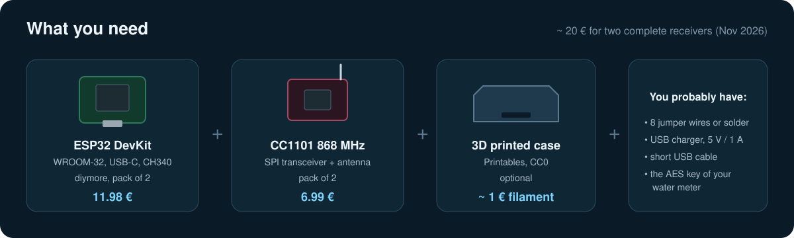

# 1 · Hardware

[← README](../README.md) · next: [2 · Wiring →](02-wiring.md)

## Shopping list

| Part | Link | Price (Nov 2026) | Notes |
|---|---|---|---|
| ESP32 DevKit, USB-C, CH340 | [diymore ESP32 NodeMCU, 2 pcs](https://www.amazon.de/dp/B0D9BTQRYT) | 11.98 € | ESP32-WROOM-32, 4 MB flash, 38 pins |
| CC1101 868 MHz | [CC1101 868 MHz UHF transceiver, 2 pcs](https://www.amazon.de/dp/B0FB3K3CQP) | 6.99 € | SPI, 3.3 V, antenna included |
| Case | [Printables 1736736](https://www.printables.com/model/1736736-esp32-cc1101-case-usb-c-devkit) by danoman | filament | made for exactly this board, CC0 |
| Jumper wires or thin wire | – | – | 8 connections |
| USB charger + cable | – | – | 5 V, at least 1 A, short cable |

Both packs contain two pieces, so you end up with a spare receiver (or one for a neighbour who also has
a radio water meter).

## Why these parts

### ESP32 instead of ESP8266 or Raspberry Pi

- The wM-Bus component for ESPHome runs on the ESP32 family. AES decryption, parsing and WiFi at the
  same time is too much for an ESP8266.
- A Raspberry Pi with an RTL-SDR stick and wmbusmeters also works, but costs five times as much,
  draws more power and needs maintenance. The ESP32 just runs.
- The **classic ESP32-WROOM-32** (dual core) is the best tested target. C3/S3/C6 boards work too, but
  need different pins.

### This particular board

- **USB-C** and a **CH340** USB-serial chip. Works out of the box on Linux and macOS, on Windows the
  CH340 driver installs automatically.
- The printed case on Printables is made for this board size (about 52 × 28 mm).
- Two boards for 12 €.

> [!NOTE]
> My board shipped with an **XTX XT25F32B** flash chip. It works, but it is picky about the supply
> voltage while writing. See [troubleshooting](06-troubleshooting.md#ota-update-fails-or-the-board-is-dead-after-an-update).
> Reading (normal operation) is no problem at all.

### CC1101 868 MHz

- The CC1101 from Texas Instruments is *the* classic chip for wM-Bus. It understands the 2-FSK
  modulation at 100 kchip/s that T1 and C1 meters use.
- It is cheap, runs on 3.3 V and talks SPI, so it connects to the ESP32 with eight wires.
- Alternatives: SX1276 (LoRa boards like Heltec / TTGO) and SX1262 are supported by the same component
  and are a bit more sensitive. If you already own such a board, use it. For a new build the CC1101 is
  the cheapest option.

> [!IMPORTANT]
> Only the **868 MHz** variant works. The matching network on the module is tuned for one band.
> A 433 MHz module on 868 MHz is practically deaf.

### Antenna

The module comes with a small spring or stick antenna. That is enough if the receiver sits near the
meter. If you need more range, a straight wire of **8.2 cm** (λ/4 at 868 MHz) soldered to the antenna
pad works well. Keep it vertical and away from metal pipes.

## Power supply

The ESP32 draws short peaks of 300–400 mA when WiFi transmits. Normal operation is happy with almost any
USB charger. **Writing the flash (firmware updates) needs a clean, stable supply.** On my first charger
with a long, thin cable the flash writes went wrong. Use a branded phone charger and a short cable, or do
updates on the PC's USB port (see [troubleshooting](06-troubleshooting.md)).

## Where to put it

As close to the meter as practical. Half a metre to two metres is perfect. The meter's antenna is
weak and the radio signal is often shielded by the meter pit, pipes or concrete. What I measured:

| Position | Signal | Telegrams received |
|---|---|---|
| Desk, two floors above the meter | -74 dBm | some, most with bit errors (dropped) |
| Basement, first spot behind a pipe | – | 1 in 2 minutes, with bit errors |
| Basement, 0.5 m next to the meter | -32 … -40 dBm | 100 % |

WiFi in the basement was -50 dBm, which is plenty. If your WiFi does not reach the meter, an ESPHome
device can also run on Ethernet boards (WT32-ETH01, Olimex ESP32-POE) with the same configuration.
