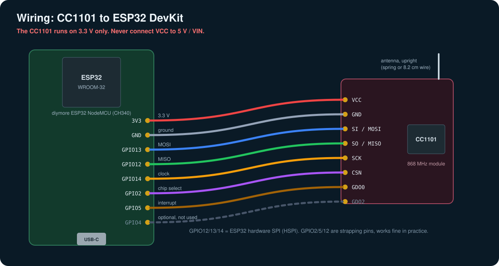

# 2 · Wiring

[← 1 · Hardware](01-hardware.md) · next: [3 · AES key →](03-aes-key.md)



## Pin table

| CC1101 pin | ESP32 pin | ESPHome key | Notes |
|---|---|---|---|
| VCC | 3V3 | – | **3.3 V only.** 5 V kills the module |
| GND | GND | – | any GND pin |
| SI (MOSI) | GPIO13 | `spi: mosi_pin` | HSPI hardware pin |
| SO (MISO) | GPIO12 | `spi: miso_pin` | strapping pin, see below |
| SCK | GPIO14 | `spi: clk_pin` | HSPI hardware pin |
| CSN | GPIO2 | `wmbus_radio: cs_pin` | strapping pin, see below |
| GDO0 | GPIO5 | `wmbus_radio: irq_pin` | "RX FIFO filled" interrupt. **Without it nothing is received** |
| GDO2 | GPIO4 | – | not used by the current component, can stay connected |

The pin names on the CC1101 boards vary a bit: sometimes `MOSI/SI`, `MISO/SO/GDO1`, `SCLK/SCK`,
`CSN/CS/SS`. Pin 1 is usually marked with a square pad.

## Step by step

1. **Check the module first.** Make sure the label or the listing says 868 MHz.
2. **Power.** CC1101 `VCC` to the ESP32 pin labelled **3V3** (not `VIN`, not `5V`).
   `GND` to `GND`.
3. **SPI.** `SI` to GPIO13, `SO` to GPIO12, `SCK` to GPIO14.
4. **Control.** `CSN` to GPIO2, `GDO0` to GPIO5. Optionally `GDO2` to GPIO4.
5. **Antenna.** Screw or solder it on and keep it pointing up.
6. **Double check** 3V3 / GND with a multimeter before you plug in USB.

Jumper wires are fine for a first test. For the permanent installation I soldered the wires directly,
the module then sits next to the ESP32 in the printed case.

## Why these pins

- GPIO12, 13 and 14 are the native pins of the ESP32's second SPI controller (HSPI), so ESPHome uses
  the hardware SPI without any pin matrix tricks.
- GPIO2, GPIO5 and GPIO12 are **strapping pins** (the ESP32 reads them at boot). This layout is the
  default used by the wM-Bus component and works fine in practice: the CC1101's `SO` pin is
  high-impedance or low while the ESP32 boots, so the flash voltage strap stays correct. ESPHome would
  warn about it; the configuration sets `ignore_strapping_warning: true` on those three pins.
- If you ever have trouble entering the bootloader or booting, move `CSN` to GPIO15 and change
  `cs_pin` accordingly.

## Quick hardware check before flashing

You can see whether the CC1101 is alive without any special tools: on the first boot of the AquaBridge
firmware the log must **not** show

```text
[E][CC1101]: Invalid part number: FF (expected 0x00)
```

That message means the ESP32 cannot talk to the chip over SPI: check MOSI/MISO/SCK/CSN and 3V3.
