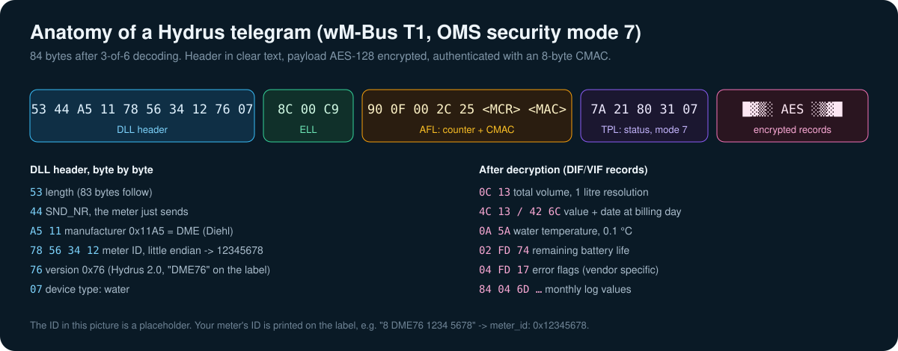

# 7 · How it works

[← 6 · Troubleshooting](06-troubleshooting.md) · [README](../README.md)

## Wireless M-Bus in two minutes

Wireless M-Bus (EN 13757-4, OMS) is the radio standard most European heat, gas and water meters use.
The meter is battery powered, so it never listens. It just broadcasts its data every few seconds and
goes back to sleep.

| Mode | Direction | Frequency | Encoding | Data rate |
|---|---|---|---|---|
| **T1** | meter → collector | 868.95 MHz | 3-of-6 | 100 kchip/s |
| **C1** | meter → collector | 868.95 MHz | NRZ | 100 kchip/s |
| S1 | meter → collector | 868.3 MHz | Manchester | 32.768 kchip/s |

The utility drives past once a year with a receiver ("walk-by / drive-by"), or installs a fixed
network. AquaBridge is just one more receiver, in your basement.

## The receive path

1. **Radio.** The CC1101 is configured for 868.95 MHz, 2-FSK, ~100 kbit/s, and looks for the wM-Bus
   sync word `0x543D`. When its RX FIFO holds 32 bytes, it pulls **GDO0** low.
2. **Read.** A high priority FreeRTOS task on the ESP32 wakes up on that interrupt and drains the FIFO
   over SPI. From the first bytes it knows the length of the frame.
3. **Decode.** T1 frames are 3-of-6 encoded: every 4 bits become a 6-bit symbol with exactly three
   ones. A Hydrus frame is 144 bytes on air, 96 bytes after decoding and 84 bytes once the block CRCs are checked and removed. A single
   invalid symbol or a CRC error drops the frame, which is why a weak signal gives you nothing rather
   than wrong values.
4. **Match.** The header contains manufacturer, ID, version and device type. Only frames whose ID
   matches `meter_id` are processed further.
5. **Decrypt.** The Hydrus uses OMS security mode 7: an ELL and an AFL layer with a message counter and an
   8-byte CMAC, then the TPL with AES-128-CBC. The session key is derived from your key and the counter.
   A wrong key fails the CMAC check, so you never get garbage values.
6. **Parse.** The wmbusmeters driver walks the DIF/VIF records (`0C13` = volume with 3 decimals,
   `0A5A` = flow temperature, `02FD74` = battery, …) and turns them into named fields like `total_m3`.
7. **Publish.** ESPHome sensors pick their field and send the value over the encrypted native API to
   Home Assistant.

## What a Hydrus telegram contains

| Record | Meaning | AquaBridge sensor |
|---|---|---|
| `0C 13` | total volume, litre resolution | Total |
| `4C 13` + `42 6C` | volume and date at the billing date | Total at billing date |
| `0A 5A` | water temperature, 0.1 °C | Water temperature |
| `02 FD 74` | remaining battery life | Battery life |
| `04 FD 17` | error flags (vendor specific, not decoded) | – |
| `84 04 6D` / `8C 04 13` | monthly log entry | – |
| TPL status byte | `0x80` on a Hydrus in normal operation | Meter status (`UNKNOWN_80`) |

Utilities can configure which records the meter sends. Yours may differ slightly.

## The firmware choices in `aquabridge.yaml`

| Setting | Why |
|---|---|
| `framework: esp-idf` | the current component only supports ESP-IDF |
| `loop_task_stack_size: 32768` | decryption and parsing run in the loop task; 8 KB overflows |
| `external_components` pinned to a commit | the `main` branch moves fast; a pin keeps builds reproducible |
| explicit `components:` list | the repository also contains an outdated `esp32` override that breaks the build |
| `mode: [T1, C1]` | meters are configured for one of the two, receiving both costs nothing |
| filter on `Total` | drops 0 / NaN / decreasing values so the statistics never get a fake reset |
| `Meter reception` binary sensor | computed on the ESP32 from the time of the last telegram |
| `Last telegram` as ISO text | a numeric timestamp over the API is a float32 and loses ~2 minutes of precision |
| `logger: INFO`, CC1101/wmbus at ERROR | radio noise and neighbours' meters would flood the log otherwise |

## Privacy

- The meter only transmits. Nothing in this project ever sends anything to it.
- The AES key stays on the ESP32 and in your `secrets.yaml`.
- The connection to Home Assistant is encrypted (Noise protocol, API key), OTA updates too.
- The receiver also hears your neighbours' meters, but without their keys it only sees IDs and
  encrypted data, and it discards them.
